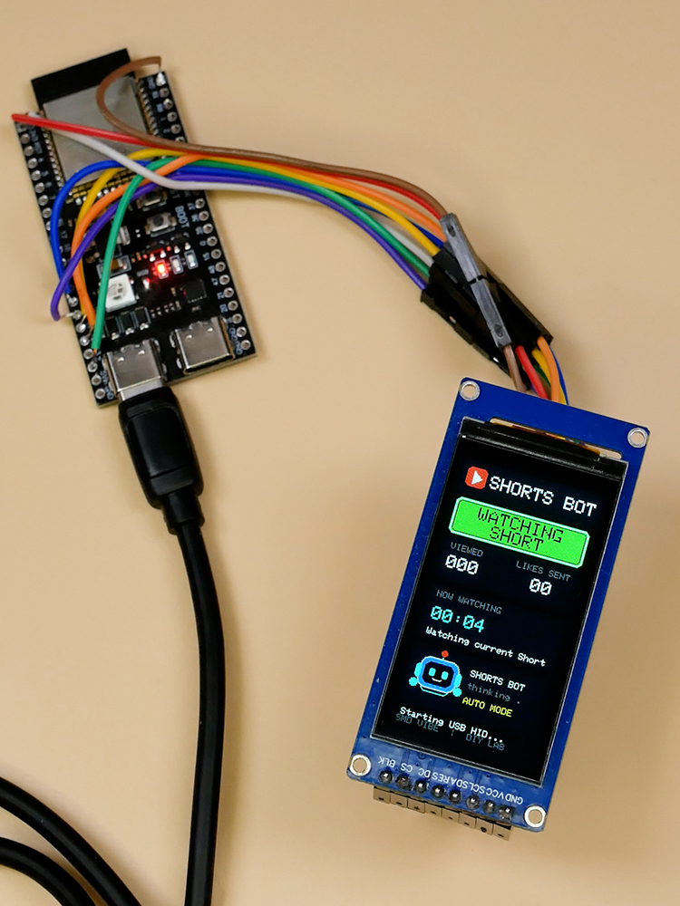
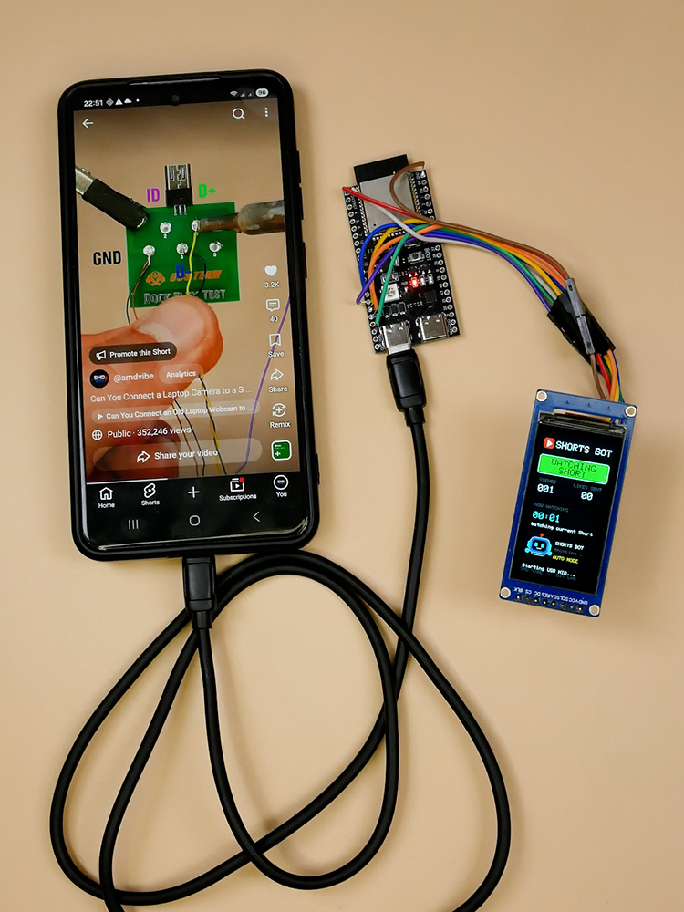

# ESP32-S3 YouTube Shorts Bot 🤖📱

A DIY electronics experiment by **SMD VIBE**: an ESP32-S3 development board with a color ST7789 TFT display that sends USB HID input reports to a smartphone and displays a robot-style status dashboard.

> **Important:** The counters show commands sent by the device. They do not verify actual YouTube views, watch time, or successful likes.

## Project photos

**Full setup**

**Hardware close-up**

## Features

- Animated robot-style TFT interface
- Status labels: `WATCHING SHORT`, `DOUBLE TAP / LIKE`, and `SWIPE TO NEXT`
- On-screen counters for actions sent
- Countdown display while an action is in progress
- USB HID smartphone-control experiment
- Partial screen redraws intended to reduce visible flicker

## Hardware

- ESP32-S3 development board
- ST7789 SPI TFT display, 170 × 320
- USB data cable and a suitable OTG/USB connection for the target phone
- Smartphone with USB host/OTG support
- Jumper wires

## Example display wiring

The sketch currently uses these example GPIO assignments. **Verify the definitions in the sketch and your actual wiring before powering the circuit.**

| ST7789 signal | ESP32-S3 GPIO |
|---|---:|
| SCK / CLK | GPIO 12 |
| MOSI / SDA | GPIO 11 |
| CS | GPIO 10 |
| DC | GPIO 9 |
| RST | GPIO 14 |
| BL / LED | Depends on your display module |

Some displays label MOSI as `SDA`. Do not apply 5 V to GPIOs that are only 3.3 V tolerant.

## Arduino IDE setup

1. Install Arduino IDE.
2. Install **esp32 by Espressif Systems** in Boards Manager.
3. Select the board that matches your hardware. `ESP32S3 Dev Module` is a common starting point.
4. Install the libraries used by the sketch:
   - Adafruit GFX Library
   - Adafruit ST7735 and ST7789 Library
   - Adafruit NeoPixel
5. Open `ESP32-S3-YouTube-Shorts-Bot.ino`.
6. Verify the display GPIOs and USB configuration, then compile and upload.

### USB HID compatibility

USB HID support depends on the installed ESP32 Arduino core version and USB configuration. If compilation fails on `USBHID`, `USBHIDDevice`, or `USB.begin()`, verify that the installed core and selected USB mode support the USB HID API used by this sketch. USB settings and APIs can differ between core versions.

## How it works

The ESP32-S3 draws the interface on the TFT and sends USB HID input reports according to the sketch's action sequence. The display reports the simulated action and counts commands sent by the device. Smartphone behaviour can vary with the phone, Android version, USB adapter, and app version.

## Troubleshooting

- **Blank display:** Check power, backlight, SPI wiring, rotation, and GPIO definitions.
- **Incorrect orientation or colors:** Check ST7789 initialization and rotation settings.
- **Visible flicker:** The sketch uses partial updates, but display power, backlight, and hardware can also affect flicker.
- **USB HID compile errors:** Check the installed Espressif ESP32 core version and USB API compatibility.
- **Phone does not respond:** Verify USB OTG/host support and use a data-capable cable or adapter.

## Responsible use

This project is intended for learning and personal experimentation. Follow YouTube's terms and the rules of any platform you use. Do not use automation to manipulate engagement metrics, spam interactions, or interfere with other users.

## Video demo

Add your YouTube Shorts URL here:

`https://www.youtube.com/shorts/YOUR_VIDEO_ID`

## GitHub topics

`esp32-s3` · `arduino` · `usb-hid` · `st7789` · `tft-display` · `diy-electronics` · `embedded-systems` · `smd-vibe`

---

Made with curiosity and electronics by **SMD VIBE** ⚡
